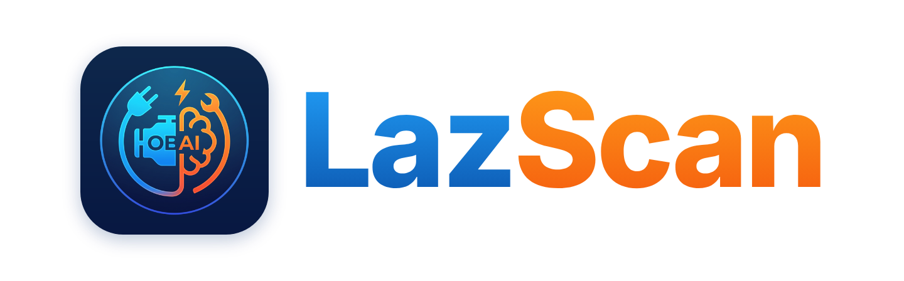
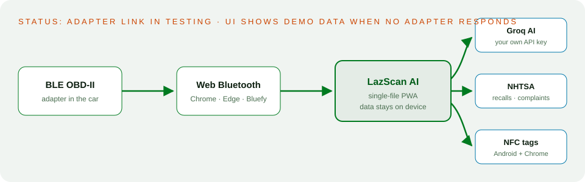

<p align="center"></p>

# LazScan

OBD-II diagnostics in an installable web app. Reads fault codes and live data from a Bluetooth LE adapter, explains them with AI (your own Groq key), checks NHTSA recalls and tracks parts with NFC tags. Single-file PWA, no build step, no app store. Part of [LAZLAB Creations](https://johnlaz.github.io/).

> **Status: beta.** The BLE connection and the Tesla tools have been run on a real car (2016 Model X 75D) with a Veepeak OBDCheck BLE adapter. Generic OBD-II reading (VIN, fault codes, live PIDs) has so far only been verified end to end against a simulated ELM327 adapter, so expect rough edges on other cars. Demo Mode runs the same engine against the simulated adapter and is always labelled as demo data. Tesla battery figures are screening estimates, not an official battery test.

## Live URLs

| | |
|---|---|
| Landing page | https://johnlaz.github.io/lazscan/ |
| App | https://johnlaz.github.io/lazscan/app/ |

## How it works

<p align="center"></p>

1. **Connect.** Web Bluetooth lists nearby devices; LazScan finds the adapter's serial characteristic automatically (FFF0, FFE0, 18F0 and a few vendor services).
2. **Initialise.** `ATZ`, `ATE0`, `ATL0`, `ATS0`, `ATH0`, `ATAT1`, `ATSP0`, then `0100` to wake the bus and read which PIDs the car supports.
3. **Read.** VIN (`0902`), MIL status (`0101`), codes (`03`, `07`, `0A`), then a polling loop over the supported live PIDs (RPM, speed, coolant, load, fuel trim, battery).
4. **Understand.** Codes get plain-English descriptions and severity. LazAI gets the vehicle, codes and live data as context.

## Features

- **Live vitals** with a rolling RPM / speed chart (drawn on canvas, no CDN dependency)
- **Fault codes**: stored, pending, permanent; severity; clear codes with confirmation
- **LazAI**: chat about your car, Groq model picker that loads the current model list from your key
- **Garage**: VIN decode, NHTSA recalls and complaint count, NFC component tags
- **Report**: print / save a PDF
- **Tesla tools (beta)**: used-Tesla battery estimate (pick model and trim, no adapter), live pack monitor (voltage, current, power, BMS energy report, capacity-from-charge, 12 V rail), alert-code lookup with LazAI, plus read-only CAN probe and logger. See below.
- **Themes**: Garage Day (default), Midnight, Auto. Units: imperial or metric
- **PWA**: installable, offline app shell, checks for a newer version on launch, on return to the app and every 30 minutes
- **Back button**: closes sheets, returns to Scan, and asks for a second press before ending a live connection

## Tesla tools (beta)

Open **Tesla tools** on the Scan screen (or Settings).

| Tool | What it does | Needs |
|---|---|---|
| Used Tesla battery estimate | Pick model and trim (rated range fills in), enter range shown and battery %, get estimated health, a band, and a save-and-compare list with print/PDF export | Nothing |
| Pack monitor | Pack voltage, current, power, energy in/out, the car's energy report (full, remaining, usable, reserve), capacity-from-charge, 12 V rail | BLE adapter + Tesla diagnostic cable |
| Alert lookup | Subsystem hint, search link and LazAI explanation for a code typed from Service Mode → Service Alerts | Groq key for the AI part |
| CAN probe / CAN logger | Advanced, read-only tools for checking what an adapter can hear | BLE adapter + cable |

Notes:
- Decoded from CAN messages 0x102 (pack voltage and current), 0x382 (energy report) and 0x3D2 (lifetime counters). Validated on one 2016 Model X 75D: charge level matched the car display. Other model years may differ. Lifetime counter labels are unconfirmed.
- Listening only. LazScan never sends commands to the car, and it **cannot read stored alert codes**; that needs active diagnostic requests. Type the code in from the car's screen.
- The 12 V reading comes from the adapter's own voltage sensor (about every 30 s, with a one-second data gap). Voltage only, not battery health.
- Rated-range data comes from a community cheat sheet and is not independently verified. Range depends on year and wheels, so the picker offers Low / Mid / High for trims with a spread.
- Classic Bluetooth adapters (OBDLink LX and similar) cannot be used by Web Bluetooth.

## Repo layout

```
/index.html            landing page
/README.md
/docs/                 banner logo + README diagram
/app/index.html        the app (single file)
/app/manifest.json
/app/sw.js
/app/icon-192.png
/app/icon-512.png
/app/shot-scan.png     install screenshots (demo mode captures)
/app/shot-codes.png
/app/shot-desktop.png
/.nojekyll
```

## Hardware and browsers

| Adapter | Protocol |
|---|---|
| Veepeak OBDCheck BLE | BLE (tested) |
| OBDLink CX | BLE |
| Vgate iCar Pro | BLE |
| vLinker MC+ | BLE |

Any BLE ELM327-style adapter that exposes a serial service should work. Classic Bluetooth (non-BLE) adapters will not. Chrome (Android, desktop), Edge (Windows), Bluefy (iPhone). On iPhone do **not** pair the adapter in system Bluetooth settings.

## AI / model setup

1. Create a free key at [console.groq.com](https://console.groq.com).
2. Paste it in **Settings → Save Key**. The model list is fetched from Groq and can be refreshed any time. Your selected model is never swapped automatically; if it disappears from Groq's list it is kept and flagged.
3. Default model: `llama-3.3-70b-versatile`.

## Data and privacy

Key, notes, tags, theme and saved vehicle live in `localStorage` on your device. There is no LAZLAB server. Network calls go only to Groq (AI), NHTSA (VIN decode, recalls, complaints). Demo data is never saved.

## Deploy / update

Pages: **Settings → Pages → Deploy from branch `main` / root**. After changing the app, bump `VERSION` in `app/index.html` **and** `CACHE_NAME` / `CDN_CACHE_NAME` in `app/sw.js` together so installed copies update. Installed copies check for the new service worker on launch, when the app returns to the foreground, every 30 minutes, and from **Settings → Check for updates**. An update never reloads the page during a live connection.

## Known limitations

- Generic OBD-II reading is not yet verified on a range of real vehicles. Protocol quirks (older K-line / J1850 cars, clone adapters) may need fixes.
- Tesla tools are beta and validated on one car. Standard OBD-II PIDs return nothing on a Tesla; the pack monitor uses raw CAN messages.
- Only generic OBD-II (SAE J1979) data. No manufacturer-specific modules (ABS, airbag, transmission).
- DTC descriptions cover ~116 common generic codes; others fall back to a generic label and LazAI.
- Web Bluetooth is not available in Safari on iPhone (use Bluefy).

## Changelog

| Version | Notes |
|---|---|
| v2.9.0 | Back-button guard, background update checks, Check for updates, new banner. |
| v2.8.0 | Cleaner Tesla pickers, kWh removed from the picker, print/PDF export of saved estimates. |
| v2.7.0 | Model and trim picker fills rated range for the used-Tesla estimate. |
| v2.6.0 | Tesla tools gathered in one place on the Scan screen and Settings. |
| v2.5.0 | 12 V reading and alert-code lookup with LazAI. |
| v2.0.2–v2.4.1 | Rewritten BLE connection (fixes "GATT not supported" on Veepeak). Tesla pack monitor, energy report, capacity-from-charge, used-Tesla estimator, CAN probe and logger. |
| v2.0.1 | Renamed to LazScan. New high-resolution icon and wordmark. |
| v2.0.0 | Rebuilt. Real ELM327 engine over Web Bluetooth (fixes the invalid short-UUID bug that always fell into demo mode). iOS-style interface. New brand palette from the new icon. Groq model picker. Chart.js removed. Demo Mode is explicit and labelled. New icons and screenshots. |
| v1.0.1 | Garage Day default theme, landing + `/app` layout, service worker fixes |
| v1.0.0 | Initial release (simulated data only) |

---

© 2026 LAZLAB Creations. All Rights Reserved. · lazlab.io@gmail.com
